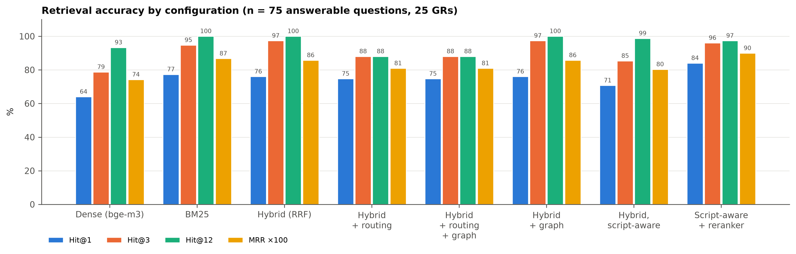
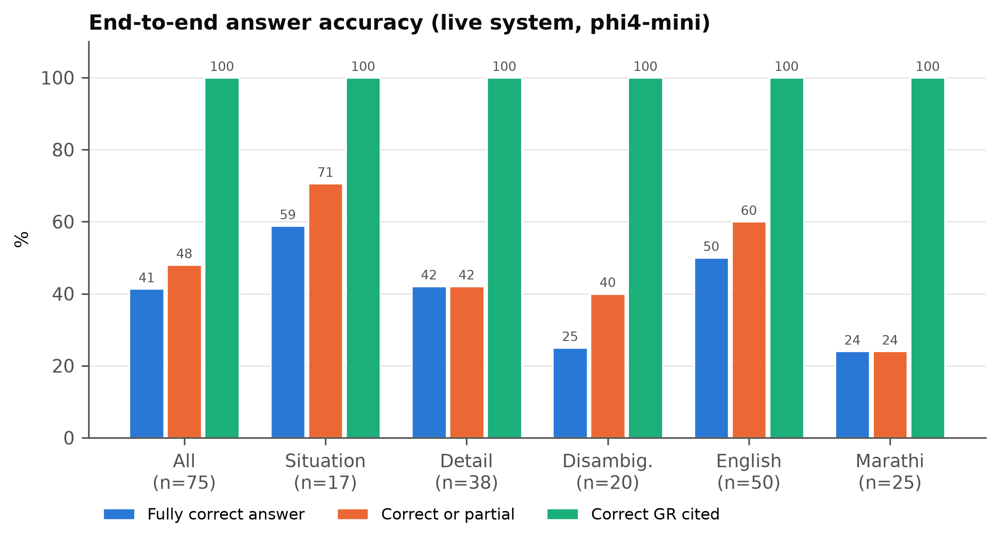

# Niyamsetu (नियमसेतु)

Context-aware conversational AI platform for querying Maharashtra Government Resolution (GR) documents in English and Marathi.

## Problem

Maharashtra government issues 800+ GRs annually, stored as scanned, unsearchable PDFs on portals like Aaple Sarkar. Officials waste hours finding specific clauses. Niyamsetu enables natural language querying, auto-summarization, and GR relationship detection (supersession/amendment) — fully on-premise for DPDP Act compliance.

## Tech Stack

- **Backend:** FastAPI, MongoDB (Motor), FAISS, LangChain, Ollama (qwen2.5:14b for generation, bge-m3 for embeddings)
- **Frontend:** React 19, Vite, Tailwind (base styles only), Axios, React Router
- **Auth:** JWT (python-jose), bcrypt password hashing

## Prerequisites

- Python 3.13
- Node.js 18+
- MongoDB running locally on `localhost:27017`
- Ollama, with both models pulled on whichever host serves it:
  ollama pull qwen2.5:14b
  ollama pull bge-m3

  qwen2.5:14b does not fit the dev laptops, so Ollama currently runs on a
  Google Colab GPU and is reached over a tunnel — `OLLAMA_BASE_URL` points at
  the tunnel URL instead of localhost. Install Ollama locally
  (https://ollama.com) only if you are serving the models yourself.
  Note it is qwen2.5, NOT qwen2.5-coder — the coder variant is
  code-specialised, and this corpus is Marathi government prose.

## Setup

### 1. Clone and configure

git clone https://github.com/Abhushan187/niyamsetu.git
cd niyamsetu

Create `backend/.env`:
````
MONGODB_URL=mongodb://localhost:27017
DATABASE_NAME=niyamsetu
JWT_SECRET=change-this-to-something-random
JWT_EXPIRE_HOURS=24
OLLAMA_BASE_URL=http://localhost:11434   # or the Colab tunnel URL
EMBEDDING_MODEL=bge-m3
LLM_MODEL=qwen2.5:14b
DATA_DIR=./data
````
### 2. Backend

cd backend
python -m venv .venv
.\.venv\Scripts\Activate.ps1      # Windows PowerShell
# source .venv/bin/activate       # macOS/Linux

pip install -r requirements.txt --only-binary=:all:
uvicorn main:app --reload --host 0.0.0.0 --port 8000

Backend runs at http://localhost:8000. API docs at http://localhost:8000/docs.

### 3. Frontend

cd frontend
npm install
npm run dev

Frontend runs at http://localhost:5173.

### 4. Start Ollama (separate terminal)

ollama serve

Skip this if `OLLAMA_BASE_URL` points at the Colab tunnel — the models are
already being served there.

## Default Credentials

Seeded automatically on first backend startup if the `users` collection is empty.

| Username | Password  | Role  |
|----------|-----------|-------|
| admin    | admin123  | admin |
| user1    | user123   | user  |

**Change these before any real deployment.**

## Project Structure

```
niyamsetu/
├── backend/
│   ├── auth/       — JWT auth, login, user management
│   ├── api/        — HTTP route handlers (upload, embed, query, graph, summary, logs, sessions)
│   ├── core/       — business logic (RAG pipeline, vectorstore, graph detection, summarizer)
│   ├── db/         — MongoDB read/write operations
│   └── data/       — grdocs/ (uploaded PDFs), vectorstore/ (FAISS), summaries/ (generated)
└── frontend/
    └── src/
        ├── pages/       — route-level pages
        ├── components/  — shared UI (Navbar, Sidebar, Layout)
        ├── context/      — AuthContext, ChatContext
        └── api/          — Axios client
```

## Graph, metadata and evaluation

Three pages and two scripts sit on top of the retrieval layer. None of
them calls the chat model: everything below is derived from the chunks the
vector store already holds, so it can be rebuilt in seconds without
re-embedding anything.

### Pages

| Route | What it answers |
|---|---|
| `/graph` | Which GRs supersede, amend or cite which others. Nodes are coloured by issuing department and labelled with the GR number; a timeline slider shows the graph as it stood on any document date. Grey nodes are documents the corpus cites but does not contain. Clicking one lists what it cites and what cites it, with the evidence snippet. |
| `/registry` | Every embedded document as one row — file, GR number, department, date, subject, and how many documents it cites and is cited by. Searchable across all text columns, filterable by department, sortable by file, department or date. |
| `/search` | The same hybrid retrieval the chat answers from, with no model in the way. Each result shows where the dense and BM25 retrievers ranked it, so a wrong-looking result can be attributed to one half or the other. Warns when dense retrieval is unavailable. |

All three are available to any logged-in user.

### Where the data comes from

The graph and the metadata table are both derived from chunk text and
written as JSON snapshots beside the index:

- `data/gr_graph.json` — nodes and edges
- `data/gr_meta.json` — one metadata row per document

Both are written automatically at the end of an embedding run, and can be
rebuilt on their own at any time:

```
cd backend
python scripts/build_graph.py
```

That reads the existing index, rewrites both snapshots, prints the node
and edge counts (resolved, external, and how many noisy reference items
were dropped), then one line per edge and one line per document. It never
writes to MongoDB and never re-embeds.

### Retrieval scoring

```
cd backend
python tests/score_retrieval.py
python tests/score_retrieval.py --questions tests/harness_questions.json --top-k 12
```

Scores five retrieval configurations — `dense_only`, `bm25_only`,
`hybrid`, `hybrid_routed`, `hybrid_routed_graph` — against
`tests/harness_questions.json`, reporting hit@1/3/5/12, MRR and the mean
number of distinct files in the context, overall and per tier. Results are
written to `tests/retrieval_scores_<timestamp>.json` and `.md`.

It calls no chat model. The four configurations that need a query
embedding are reported as unavailable if the embedding endpoint is down,
and `bm25_only` still runs.

**The numbers are a lower bound.** Many harness questions do not name a
document — "शासन निर्णयाचा दिनांक काय आहे?" is ambiguous against a corpus
where every GR has a date — so a defensible retrieval is scored as a miss
whenever another document would have answered equally well. The figures
are comparable *between* configurations, which is what they are for.

### Feature flags

Both default to off, and with them off the system behaves exactly as it
did before they existed. Set them in `backend/.env`.

**`META_FASTPATH`** — answers header questions (date, department, GR
number) straight from `gr_meta.json`, with no retrieval and no LLM call.
It only fires when the question is short, names no digits, asks for one of
those three fields, and identifies exactly one document; anything else
falls through to the normal pipeline. In practice the document is
identified by the `focus_file` field on the chat request, since a question
that names a document by its stem usually contains a digit and is
therefore rejected by design.

The harness can exercise this end to end:

```
cd backend
python tests/run_harness.py --scoped --tag fastpath
```

`--scoped` sends each question's own `gr_file` as `focus_file`, which
removes retrieval's choice of document from the measurement.

**`GRAPH_EXPAND`** — after retrieval and routing, follows the GR
relationship graph and pulls in chunks from documents the retrieved ones
are linked to, preferring `supersedes` and `amends` over plain citations.
This is how a superseded order's replacement reaches the context at all:
the superseding GR shares almost no wording with the order it cancels, so
retrieval alone cannot find it. Citations from those chunks are marked
`via_graph` and show a "linked via graph" tag in the chat.

Tuned by `GRAPH_MAX_NEIGHBOR_DOCS` and `GRAPH_CHUNKS_PER_NEIGHBOR`.


## Evaluation results — 25 GAD Government Resolutions

All results below were produced on 2026-10-27 against the 25 General
Administration Department documents in `backend/data/grdocs/` (bilingual
text exports from [orgpedia/mahGRs](https://github.com/orgpedia/mahGRs):
Marathi original plus English translation; 1,098 chunks, bge-m3, FAISS).
Every table, figure and raw run file is in
[`backend/tests/research_results/`](backend/tests/research_results/);
[`RESULTS.md`](backend/tests/research_results/RESULTS.md) has all tables in one place.

**Test set:** 81 hand-written questions (`backend/tests/gold_gad25.json`):
75 answerable (17 situation, 38 detail, 20 near-duplicate disambiguation;
50 English, 25 Marathi) and 6 with no answer in the corpus. Every evidence
snippet was verified to occur in its expected GR.

| Measure | Result |
|---|---|
| Retrieval Hit@1 / Hit@3 / Hit@12, deployed hybrid (BM25 + dense, RRF) | 76.0% / 97.3% / 100% |
| Retrieval Hit@1 with bge-reranker-v2-m3 cross-encoder | 84.0% (≈30 s per query on CPU) |
| Answer cites the correct GR | 100% (75/75); cited first 76.0% |
| Answer fully correct (phi4-mini) | 41.3% (31/75); correct or partial 48.0% |
| Fully correct — English / Marathi questions | 50.0% / 24.0% |
| Out-of-corpus questions refused | 3/6 |
| Answer language matches question | 97.5% (79/81) |
| Median response time | 5.3 s |
| Automated test suite | 437/437 passed |
| Functional test cases (live API) | 15/18 passed |




Known gaps found by the evaluation:
- Citation links 404 for this corpus: `api/files.py` serves only `*.pdf`,
  while the corpus is indexed as `.pdf.txt` (functional test FT-06).
- Script-aware fusion (`SCRIPT_AWARE_FUSION`) lowers Hit@1 on this corpus
  (70.7% vs 76.0%), because each document carries an English translation
  that BM25 matches well.
- Most wrong answers had the right GR in context; the 3.8B generator
  misread a table, count or date.

To regenerate everything from the raw runs:

```
cd backend
python tests/score_retrieval.py --gold tests/gold_gad25.json --top-k 12
python tests/run_harness.py --gold tests/gold_gad25.json --tag gad25
python tests/make_research_report.py --retrieval tests/retrieval_scores_natural_<ts>.json \
    --harness tests/harness_natural_<ts>.json \
    --units tests/research_results/inputs/unit_results.json \
    --corpus tests/research_results/inputs/corpus.json \
    --review tests/gold_gad25_review.json \
    --functional tests/research_results/inputs/functional_tests.json
```

`make_research_report.py` needs `matplotlib` for the figures.

## Workflow for Contributors

1. Create a feature branch off `main`.
2. Backend: business logic goes in `core/`, HTTP handling in `api/`, DB ops in `db/` — never mix these.
3. Frontend: inline styles only (no Tailwind classes), state via Context, all API calls through `src/api/client.js`.
4. Open a PR — CI runs the offline test suite automatically (`test_units.py` + `test_config.py`, no external services required).
5. Before approving any PR, run the full test suite locally: `python tests/run_all_tests.py` (no `--offline` flag). This includes `test_integration.py`, which requires MongoDB and Ollama running — currently only Harsh's machine has both. Harsh should run this before approving merges to `main`.
6. PRs are reviewed before merging to `main`.

## Known Constraints

- **Do not use MongoDB Atlas** — Python 3.13 has a TLS incompatibility with Atlas. Local MongoDB only.
- **No cloud services in the deployment target** — the architecture is on-premise/air-gapped by design for DPDP Act compliance. The Colab-tunneled Ollama above is a development expedient only: document text does leave the machine while it is in use, and it must be replaced by a local GPU host before any real deployment.
- `qwen2.5:14b` is the LLM and `bge-m3` the embedding model. Neither runs usefully on the dev laptops, so Ollama is served from a Google Colab GPU over a tunnel for now. Changing `EMBEDDING_MODEL` forces a full re-embed: bge-m3 is 1024-dimensional, and a 1024-dim query vector cannot be searched against an index built at another width.

## License

Copyright application in progress. All rights reserved pending filing.
